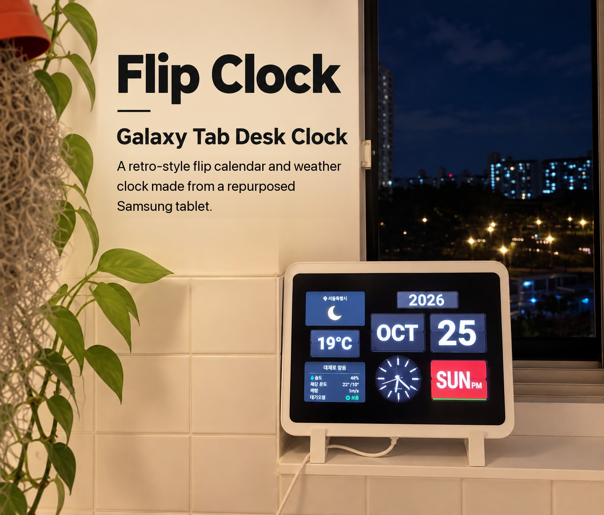
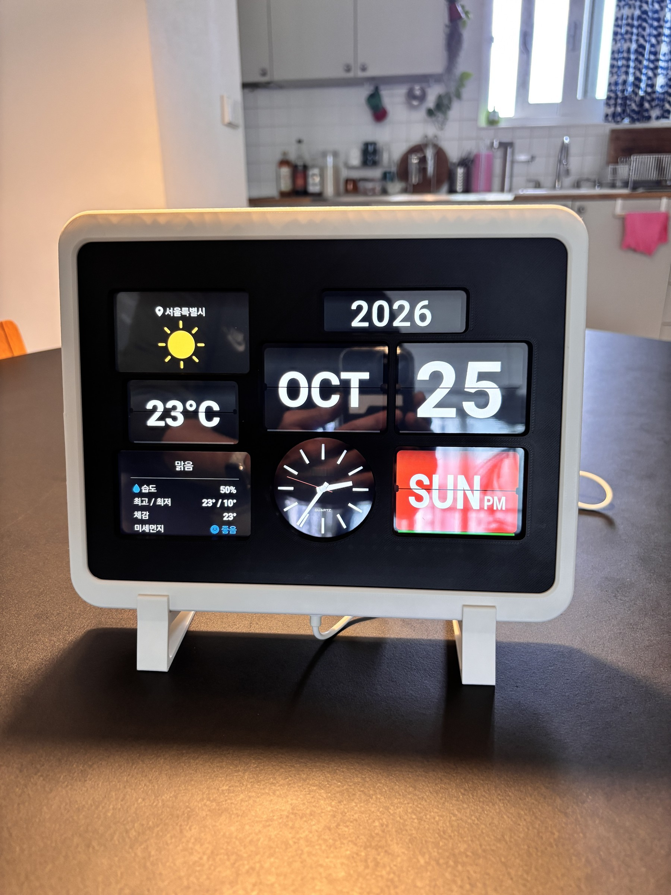
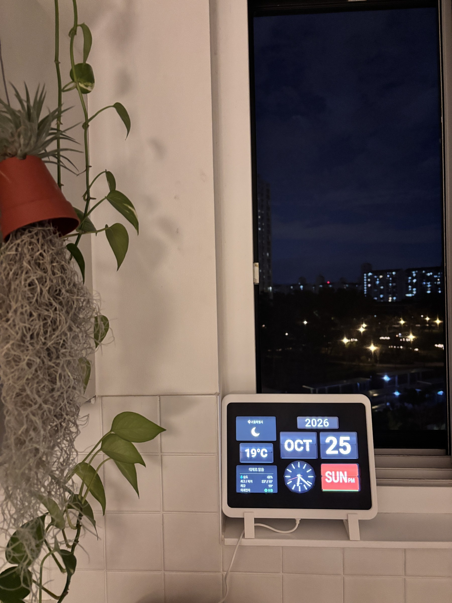
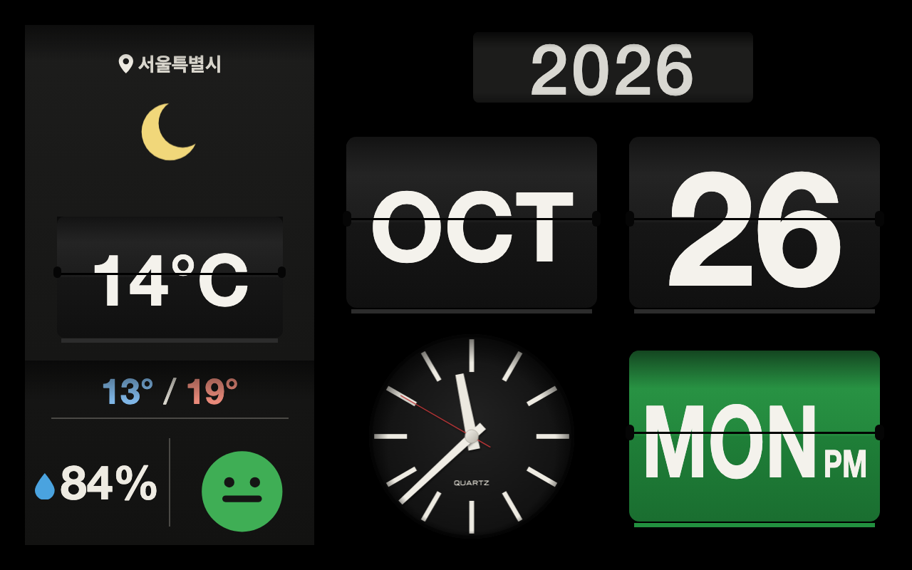
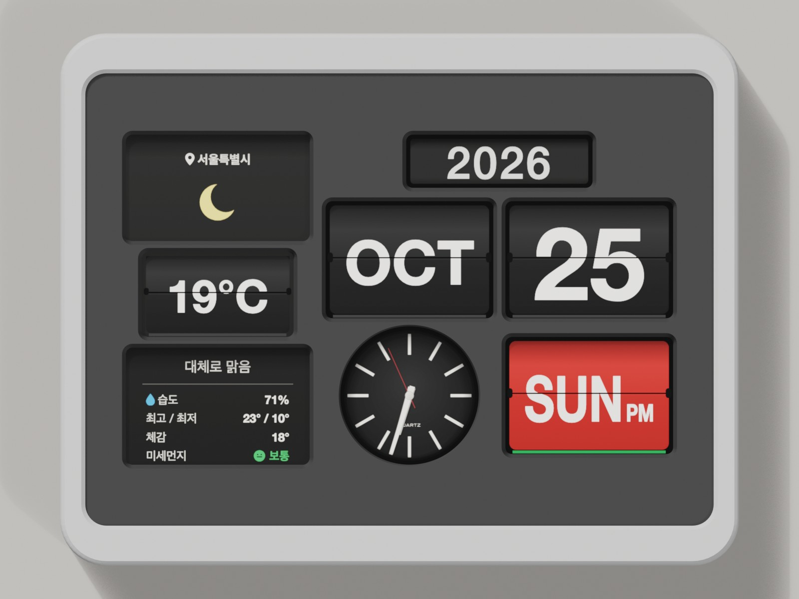
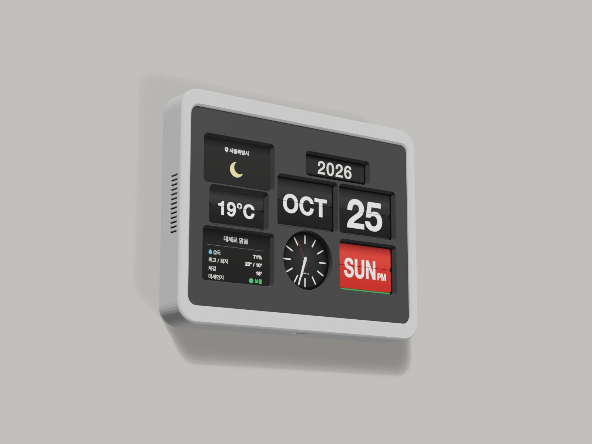
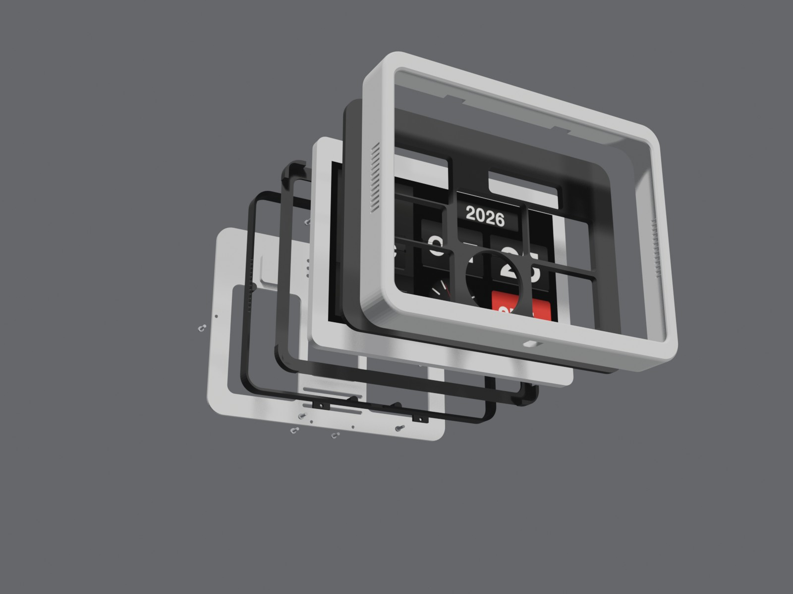

# Galaxy Tab Flip Clock

A retro flip calendar and weather clock made from an old **Samsung Galaxy Tab4 Advanced (SM-T536)**. The tablet sits in a 3D printed case. A black mask leaves only the card windows open, so the screen looks like real flip cards.

- **Web app**: `index.html`, a single file with no install needed. It runs in the tablet's Chrome.
- **Case**: 6 parts, printed without supports. `models/flip_clock_v2_full_kit.3mf` is set up for Bambu Lab X2D.

---

갤럭시탭4 Advanced(SM-T536, 1280×800)를 레트로 플립 달력 시계로 쓰는 웹앱과 3D 프린트 케이스입니다. 검은 마스크(베젤)의 창 뒤로 화면이 비쳐서 진짜 넘김 카드처럼 보입니다.

| 낮 | 밤 |
|---|---|
|  |  |

## 웹앱 (`index.html`)
- **한 파일**입니다. 글꼴과 화면 유지용 영상도 파일 안에 들어 있습니다.
- 시계와 달력은 인터넷 없이 돕니다. 날씨 창만 Wi-Fi가 필요합니다.
- 오래된 안드로이드 크롬(안드로이드 5)에서도 돌도록 ES5로 썼습니다.

### 화면 구성
- **오른쪽**: 연도 드럼, 월·일 플립 카드, 아날로그 시계, 요일 카드
  - 요일 카드는 토·일요일이 빨강, 평일이 초록입니다.
  - 연도는 해가 바뀌면 띠가 통째로 굴러 올라갑니다.
- **왼쪽 날씨 판**: 지역, 날씨 아이콘, 기온 플립 카드, 최저/최고 기온, 습도(큰 숫자), 미세먼지(얼굴 아이콘 4단계)
- **플립 소리**: Web Audio로 합성합니다. 녹음 파일은 쓰지 않습니다.

### 탭에 설치
1. `index.html`을 탭의 `Download` 폴더에 복사합니다.
2. 크롬 주소창에 `file:///sdcard/Download/index.html`을 입력합니다.
3. 화면을 한 번 누릅니다. 전체화면이 되고, 플립 소리와 화면 꺼짐 방지가 켜집니다.
4. 설정 → 개발자 옵션 → **충전 중 화면 켜짐 유지**를 켭니다.

### 설정 창
화면 **왼쪽 위 모서리를 빠르게 3번** 누르면 열립니다. 바꾼 값은 탭에 저장됩니다.
- **베젤 맞춤**: 창 윤곽을 보면서 가로·세로 위치(0.1 mm 단위)와 크기 비율을 맞춥니다.
- **날씨·소리**: 날씨 지역, 플립 소리 크기, 플립 시험
- **화면 보호**: 아래 항목을 각각 켜고 끌 수 있습니다.
  - 야간 흐리게 (23~6시)
  - 쉬는 시간 검은 화면
  - 매시 30분 화면 닦기
  - 화면 조금씩 옮기기

### 화면 꺼짐과 잔상 방지
- **화면 꺼짐 방지**: Wake Lock API는 https에서만 동작합니다. 그래서 화면 뒤에서 검은 무음 영상(2.8 KB)을 계속 재생해, 크롬이 화면을 밝게 유지하게 합니다.
- **쉬는 시간 검은 화면** (매일 0~6시, 평일 8~16시)
  - 화면을 검게 하고 화면 꺼짐 방지를 풉니다. 그러면 시스템이 백라이트를 낮춥니다.
  - 이때 화면을 누르면 5분 동안 시계가 보입니다.
- **매시 30분 화면 닦기**: 9초 동안 화면 전체가 흰색과 검은색으로 번갈아 바뀝니다. 밤에는 흰색 대신 회색입니다.
- **화면 조금씩 옮기기**: 3분마다 화면 전체를 ±0.35 mm(약 2 px) 안에서 옮깁니다.

### 날씨
- [Open-Meteo](https://open-meteo.com/) 무료 API를 씁니다. 키는 필요 없습니다.
  - 15분마다 새로 받고, 실패하면 5분 뒤 다시 시도합니다.
  - 데이터 출처 표시: Weather data by Open-Meteo.com (CC BY 4.0)
- 오래된 안드로이드는 Let's Encrypt 인증서를 믿지 못할 수 있습니다. 그래서 https가 실패하면 http로 다시 받습니다.
- 미세먼지는 PM10과 PM2.5를 환경부 4단계로 나누고, 둘 중 나쁜 쪽을 보여 줍니다.
- 지역을 더 넣으려면 `CITIES` 목록에 `[이름, 위도, 경도]`를 추가합니다.

## 케이스 (`models/`)

| 앞 | 벽걸이 | 분해 |
|---|---|---|
|  |  |  |

| 판 | 부품 | 크기 (mm) | 색 | 무게·시간 (X2D, 0.2 mm) |
|---|---|---|---|---|
| 1 | Frame (한 덩어리 외곽) | 255 × 200 × 33 | 흰색 | 약 82 g · 3h27 |
| 2 | Ring (뒤 고정 링) | 251 × 197 × 14 | 검정 | 약 29 g · 36m |
| 3 | Bezel (마스크, 창 벽 74°) | 251 × 185 × 5 | 검정 | 약 76 g · 2h05 |
| 4 | Bracket (탭 받침) | 251 × 185 × 11 | 검정 | 약 25 g · 44m |
| 5 | Cover (뒤판) | 252 × 186 × 9 | 흰색 | 약 64 g · 1h29 |
| 6 | Stand (탁상 발 2개) | 99 × 97 × 16 | 흰색 | 약 17 g · 21m |

- 합계는 약 300 g, 8.7시간입니다.
  - 서포트 없이 뽑습니다. 채움은 lightning 10 %, 벽은 2줄입니다.
  - 판 폭(256)을 거의 다 써서 브림은 넣지 않았습니다.
- 출력 판은 256 × 256 이상이어야 합니다. 3MF는 Bambu Lab X2D, PLA Matte 흰색·검정 기준입니다.
- 다른 프린터에서는 `models/stl/`의 STL을 쓰세요. 이미 출력 방향으로 놓여 있습니다.
- 겉 질감: Frame 바깥 둘레와 Bezel 창 벽에 퍼지 스킨(0.06)을 넣었습니다.

### 필요한 것
- **태블릿**: Galaxy Tab4 Advanced (SM-T536). 다른 탭은 크기가 달라 맞지 않습니다.
- **나사**: M3 × 10 둥근머리 10개
- **USB 케이블**: 아래 가운데 구멍으로 꽂아 충전 상태로 둡니다.

### 조립
1. 탭을 Bracket에 넣고 Bezel을 덮어 코어를 만듭니다.
2. 코어를 Frame **뒤에서** 넣어 앞 턱에 댑니다.
3. Ring을 뒤에서 넣습니다.
   - 위·아래 탭 4개가 Frame 뒤쪽 홈에 들어갑니다.
   - 탭을 M3 × 10 나사 4개로 Frame에 조입니다.
4. Cover를 덮고 M3 × 10 나사 6개로 Ring에 조입니다.
5. **놓는 방법**
   - **탁상**: Stand 2개에 아래 가장자리를 얹습니다. 뒤로 12° 기울어집니다.
   - **벽걸이**: Cover 뒷면의 열쇠 구멍 2개(가로 140 mm 간격)에 벽 나사를 겁니다. 나사 머리는 Ø9 이하, 몸통은 Ø4 이하여야 합니다.

나사는 PLA 구멍(Ø2.9)에 직접 파고듭니다. 자주 풀고 조이면 헐거워지니, 그럴 때는 M3 열 압입 인서트를 쓰세요.

## 화면과 케이스 좌표
- `index.html` 맨 위 `layout` JSON에 화면 기준 mm 좌표가 있습니다.
- 케이스의 베젤 창도 같은 좌표로 뚫었습니다.

## 라이선스
- **웹앱 코드** (`index.html`): [MIT](LICENSE)
- **3D 모델** (`models/`): [CC BY-NC 4.0](models/LICENSE). 출처를 표시하고 비상업적으로만 쓸 수 있습니다.
- **글꼴**: 문자판 글꼴 조각(Michroma)은 SIL Open Font License 1.1입니다.
- **날씨 데이터**: [Open-Meteo](https://open-meteo.com/) (CC BY 4.0)
- Samsung과 Galaxy는 Samsung Electronics의 상표입니다. 이 프로젝트는 Samsung과 관계없습니다.
